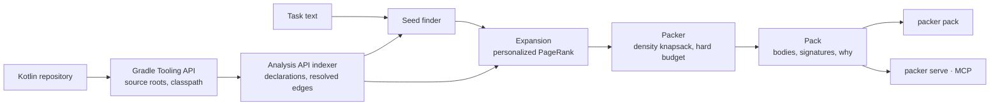

# Jetpacker

## What

Given a repository and a task description, Jetpacker builds a **token-budgeted
context pack**: resolved symbol definitions, callers, implementations, type
hierarchies, and affected tests — instead of similar-looking text chunks.

Under the hood: Kotlin Analysis API (PSI-level resolution) → typed code graph →
personalized PageRank from task seeds → density knapsack under a hard token
budget → deterministic Markdown/JSON pack. Delivered as a CLI and an MCP server.



Resolution is the part that matters: edges come from the compiler's own answer
to "what does this call?", not from a name that looks the same in twelve files.

## What a pack looks like

Jetpacker packing its own repository, for a task about the packer overshooting
its budget. Twelve seconds, and the budget is exact:

```sh
packer pack --repo . --task task.md --budget 2000
```

````markdown
# Context pack

2000 / 2000 tokens, 66 declarations.

## Definitions

### dev.jetpacker.core.pack.Packer.Companion
`core/src/main/kotlin/dev/jetpacker/core/pack/Packer.kt:160` — member-of:Packer

```kotlin
    companion object {
        const val DEFAULT_BUDGET = 4000
        const val DEFAULT_FULL_TIER_SHARE = 0.15
        ...
    }
```

## Related signatures

`core/src/main/kotlin/dev/jetpacker/core/pack/Packer.kt`
- 53: fun pack(ranked: List<Ranked>): Pack — member-of:Packer
- 82: fun consider(candidate: Ranked, fidelity: Fidelity, limit: Int) — caller-of:fileHeading
- 129: private fun byDensity(candidates: List<Ranked>, fidelity: Fidelity) — member-of:Packer
````

Every item carries **why it is there** — `seed`, `caller-of:X`, `member-of:Y`,
`same-file:Z` — so the pack can be audited instead of trusted. Bodies go to what
matters most, signatures cover the rest, and the same repository state and task
always produce a byte-identical pack.

## Why

Vector RAG retrieves text that *looks like* the task. Coding tasks often need code that is
*connected to* the task: callers of the function being changed, implementations of an interface,
tests that will break. The project tests whether compiler-resolved structural packing beats
chunk RAG and surface-level (tree-sitter) structural packing on resolve-heavy Kotlin tasks.

**The benchmark is the deliverable.** See [`docs/results.md`](docs/results.md) for what the
tables show and what they do not, [`docs/level2.md`](docs/level2.md) for patch-success runs, and
[`docs/plan.md`](docs/plan.md) for the research plan. Analysis API wiring notes live in
[`docs/analysis-api.md`](docs/analysis-api.md).

## Status

The pipeline runs end to end. On the 28 detekt tasks of JetBrains'
[Kotlin Benchmark](https://github.com/Kotlin/kotlin-swe-bench), scored from the issue text alone,
recall of the declarations each fix changed:

| | 1k | 2k | 4k | 8k |
|---|----|----|----|----|
| Jetpacker | 42.8% | 53.5% | **70.8%** | **81.2%** |
| BM25 over declarations | **48.8%** | **55.7%** | 63.9% | 70.5% |
| Chunk RAG (40-line windows, BM25) | 15.3% | 32.5% | 34.1% | 48.1% |
| Chunk RAG, same windows, embeddings | 3.1% | 10.4% | 14.0% | 14.9% |
| Aider-style repo map | 0.7% | 0.7% | 1.4% | 1.4% |
| Same seeds, no graph expansion | 29.9% | 44.6% | 57.7% | 66.5% |

Retrieving whole declarations instead of windows is the largest Level-1 win: BM25 over
declarations beats BM25 over windows on every suite. Structural expansion is worth 10–23 points
over seeds alone on detekt. The same ordering holds on ktlint (43 tasks) and ort (12) against
chunk RAG. Removing one relation at a time says callers earn most of the graph win;
implementation / supertype edges do not pay on the ktlint ablation and default to weight zero.

**Resolution itself is worth 1 to 17.8 points** against name-matched call edges, and the margin
grows with the budget. On detekt at 8k, following ambiguous name-matched edges is worse than not
expanding at all.

It does not hold everywhere. On TeXiFy, issues describe what a LaTeX user saw rather than code,
and the engine loses to BM25 at every budget. On dataframe, where only ~38% of call sites resolve,
embeddings over 40-line windows beat the engine at three budgets of four. Graph expansion also
does not reliably beat declaration BM25: a later ktlint ablation has `jp:default` ahead at 2k and
4k and behind at 8k (48.9% vs 50.8%). Read [`docs/results.md`](docs/results.md) before quoting
any of this — 97 of 105 suite tasks run at Level 1.

**Level 2** (does a better pack produce a better patch?) is documented in
[`docs/level2.md`](docs/level2.md). Sixty-three Harbor tasks are certified (20 detekt, 43 ktlint).
Detekt is complete (20/20, bodies-only 4k): high no-context floor; all retrieval arms resolve most
tasks. Ktlint is incomplete in the ledger (25/43 tasks with all four arms scored). These runs do
not establish that graph expansion improves patch success over declaration BM25. CV-ready wording:
[`docs/plan.md`](docs/plan.md) §10.

## Layout

| Module | Purpose |
|---|---|
| `core/` | index, seed, expand, rank, pack, render |
| `cli/` | `packer pack`, and `packer serve` for the MCP surface |
| `baselines/` | chunk-RAG (BM25 and embedding) / BM25 / tree-sitter baselines |
| `eval/` | benchmark harness and metrics |

## Build

Requires JDK 21.

```sh
./gradlew build
```

## Use

```sh
./gradlew :cli:installDist
cli/build/install/packer/bin/packer pack --repo /path/to/project --task task.md --budget 4000
```

Or as an MCP server over stdio, which indexes the repository once at startup and
then answers pack tools and graph queries per request:

- `get_context_pack(task, budget)` / `explain_context_pack(task, budget)` — Markdown briefing,
  or the same items with `why` and no bodies
- `callers_of(symbol)` / `implementations_of(symbol)` — resolved graph lookups

```json
{
  "mcpServers": {
    "jetpacker": {
      "command": "/path/to/jetpacker/cli/build/install/packer/bin/packer",
      "args": ["serve", "--repo", "/path/to/project"]
    }
  }
}
```

## License

[MIT](LICENSE).
